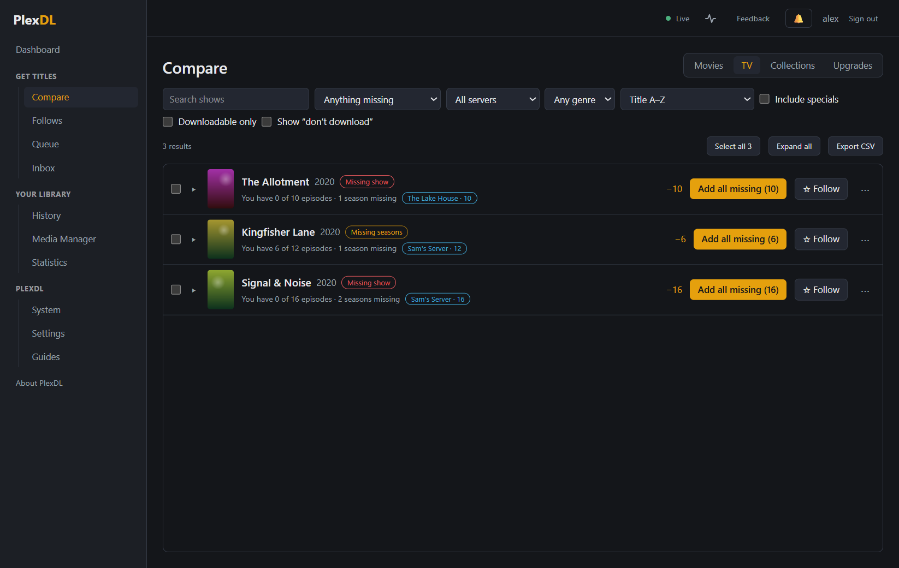
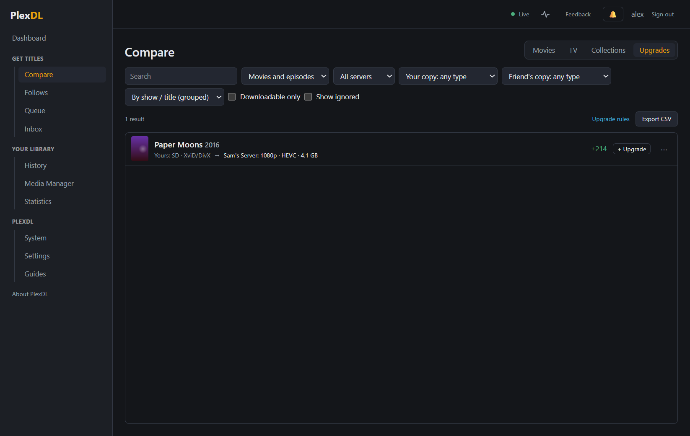
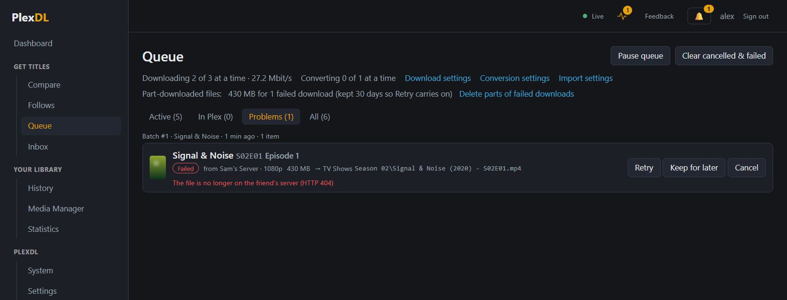
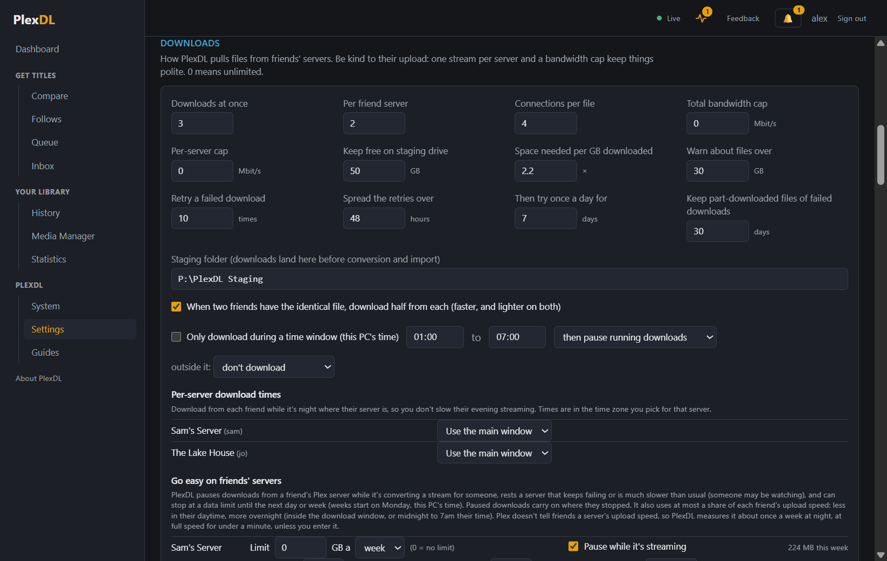

# Finding and downloading

## Keeping the lists up to date

PlexDL keeps its own index of your library and your friends' libraries. The **Dashboard** shows each server
with what you're missing from it. **Full sync** reads everything; **Quick sync** only fetches what changed.
Both also run on their own (a full sync every night and quick syncs through the day: Settings → Schedule).

Each count on the Dashboard also says roughly how much space it would take (for example "7,219 Missing movies
≈ 8.0 TB"), and so does each friend's card. Below the counts, **Getting all of it needs** adds it up and shows,
for each drive it would land on, how much is heading there and how much is free. As when PlexDL adds them, new films and
new shows go to your default film and TV library (on its drive with most room, if it has several), and
episodes for shows you have and upgrades go next to your copies. A drive that can't take it all is shown in amber, so you can pick what matters most. The sizes are your friends' files, counting the copy PlexDL would pick (the best up
to 1080p, or 4K if that's all there is). Converting often makes files smaller, so treat it as an upper
estimate. Upgrades need room for the new copy while your old one waits in the PlexDL Backup folder; once the
backup is emptied, they only take the difference.
Choose which friends' libraries count in **Settings → Compare scope**. Titles are matched by their IMDb, TMDB
and TVDB ids, not by name or library, so it doesn't matter what your friends call their libraries.

## Compare

- **Movies**: films a friend has and you don't. Filter by friend, year, genre, rating or quality; each row says
  who has it, in what quality and how big it is. Two **file type** filters pick titles by your copy's type and by
  a friend's copy's type: AVI, MKV, MP4, TS, WMV files, or HEVC/x265, H.264/x264, XviD/DivX, MPEG-2, VC-1, AV1,
  VP9 video. For example, *Your copy: AVI file* with **Already owned** lists your old AVI films, and *Friend's
  copy: HEVC / x265* shows the ones you could get as smaller HEVC files. The same filters are on **Upgrades**
  (films and episodes).
- **TV**: shows grouped by show and season. Shows you don't have at all, and the episodes missing from shows you
  do have. **Add season** or **Add all missing** takes everything missing at once.
- **Upgrades**: titles a friend has in clearly better quality than your copy (how much better, and whether 4K
  counts, is set in Settings → Upgrades).
- **Collections**: film collections and franchises (the Alien films, James Bond, Toy Story…) you have part of:
  "You have 1 of 4", with what's missing listed underneath and which friend has each one. **Download N missing**
  queues them straight away (1080p or 4K when there is one); **Add to basket** lets you review them first. To get
  several collections at once, tick them (or **Select all … with films to get**) and press **Download** in the bar
  that appears; each collection is queued as its own batch.
  **Follow** gets new parts as friends get them. Films nobody has, or that aren't out yet, are shown but not
  counted against you. PlexDL learns which collection each film is in from Plex's own catalogue after each
  sync (the first time takes a few minutes; **Look up now** starts it).

  **Collections in your Plex**: at the top of the page you can let Plex build these collections in your own
  libraries ("From 2 films" means a collection appears once you have two of its films). Tick **Also refresh the
  library's metadata** so films you already have join; Plex does that in the background and it can take a
  while.

**A–Z**: when Movies or TV is sorted by title (the default), the letters above the list go straight to the page
that letter starts on (**#** is titles starting with a number or symbol; a leading "The" or "A" is ignored, so *The
Matrix* is under M). Letters with nothing under them are greyed out.

**Pages**: long lists show 100 at a time, with the page numbers (**« Prev · 1 2 3 … 9 · Next »**) and where you are
("101–200 of 854") above and below the list. **Show … per page** picks 50, 100 or 250, remembered for each list.
Changing a filter, the sort or the search goes back to the first page. It works the same in Compare, the Queue,
the Inbox, History, Notifications, Media Manager and the basket review.

A **Downloads not permitted** badge means the owner hasn't allowed downloads from that library; those titles
are listed but can't be added.

**Don't download**: tick titles (or **Select this page**, or **Select all** for everything matching your filters)
and choose **Don't
download**, or use the ⋯ menu on one title, season or episode. They leave the lists and every count on the
Dashboard, and are never auto-followed. Changed your mind? Tick **Show "don't download"**, select them and choose
**Download after all** (or use Settings → Not downloading).

## Basket, review and queue

1. **+ Add** puts a title in the **Basket** (top right).
2. **Review** the basket before anything downloads:
   - when several friends have a title, pick the source (PlexDL suggests the best and fastest);
   - for films that come in 4K, choose 4K or 1080p (TV defaults to 1080p);
   - sizes and rough download times are shown, and PlexDL warns you if a drive would run short;
   - **Convert with** picks a [conversion profile](08-settings.md#profiles) for just these downloads (normally
     each library's, or the default).
3. **Queue** them. The **Queue** page shows every title as it downloads, converts and is added to Plex, with
   **Pause**, **Resume**, **Cancel**, **Retry** and priority. Its tabs: **Active** (everything still on its way),
   **Downloading** (only what's being downloaded right now), **In Plex**, **Problems** and **All**. **In Plex**
   lists what was added in the last week (and anything downloaded but not added to Plex yet); **History** keeps
   them all.
4. **Pause queue** stops everything: no downloads, conversions or imports start until you **Resume queue**. It asks
   how: **Pause now** stops the running downloads (they carry on from where they are when you resume), or **Pause
   when these downloads finish** lets them complete first. Meanwhile nothing new starts downloading, converting and
   adding to Plex carry on, and the button reads **Pausing…** (with **Pause now** or **Keep going**).

Downloads resume where they stopped after a restart or a dropped connection, and large files download in
several parts at once (much faster from a far-away server). Speed limits, how many run at once and night-time
windows per friend's server are in **Settings → Downloads**.

When another friend has exactly the same file (same size, and the same bytes where PlexDL checks), half of it
comes from them: faster, and lighter on both servers. Each friend's limits, busy times and download windows still
apply; if the second friend gets busy or drops out, the first one finishes the rest. You can turn this off in
**Settings → Downloads**.

### When a friend is busy: another friend's copy

Each download is queued from the friend you chose (or the one PlexDL suggested). When several friends have it:

- **A friend that's unavailable for 15 minutes** (streaming to someone when it's set to pause then, offline, over
  the limit you set, resting after errors, or outside its download window): the download moves to another friend
  whose copy is **as good or better** (the same resolution or higher; never to 4K unless it was 4K, and an upgrade
  only to a copy at least as good as the one it was queued with). PlexDL never moves it to a worse copy by itself.
  The 15 minutes carry on across a restart of PlexDL. A friend set to slow down while streaming (the default) is
  still available: fewer downloads carry on from it (one, unless you set a share), slower, and the rest of a
  batch is shared out (next point).
- **A friend that's already downloading as many as it's allowed at once** (**Settings → Downloads**): the next
  downloads in the batch start from another free friend with an equally good copy, so a big batch (a whole
  series) comes from several friends at once.
- It only moves to a friend that can start it now and isn't streaming to anyone. A download that's partly
  downloaded only moves to a friend with exactly the same file, so nothing already downloaded is wasted.
- The Queue says "from Carol · instead of Alice (paused while it's streaming to someone)". If Alice is free again
  before the download has started, it goes back to her copy.

**From…** on a waiting download lists every friend's copy, with its quality, size and whether that friend is
available. **Use this copy** downloads it from there (any copy, even a smaller one, since it's your choice), and
for an episode **Use Carol for all of Frasier** moves every waiting episode of the show to that friend, where
they have it. Episodes that have started downloading stay where they are.

### When downloads fail

- **Retries:** a failed download tries again by itself: 10 times over 48 hours to start with, soon after a blip and
  further apart later, then once a day for a week. Each retry carries on from what's already downloaded. The
  Queue shows "Retry 3 of 17 at 14:30", and a failed download says when it will try again. Change the numbers in
  **Settings → Downloads**. A file that's gone from the friend's server, or that they don't let you download,
  isn't retried.
- **A friend goes offline:** the download waits for them ("Waiting for Alice: it's offline"), checking every 10
  minutes, without using up its retries, and carries on from where it stopped when they're back. If another
  friend has a copy of the same size, it carries on from them instead. PlexDL first checks that the bytes it
  already has match their copy, and starts again if they don't.
- **Keep for later:** on a failed download, this stops the retries and keeps what's downloaded with no deadline.
  **Resume** carries on from there; **Cancel** deletes it.
- **Space:** parts of failed downloads are kept for 30 days (so **Retry** carries on), then deleted. The Queue
  and System pages show how much space they take, with **Delete parts of failed downloads**.

## Converting

Each download is checked and, if needed, converted so it plays directly on TVs, phones and browsers without
Plex converting it on the fly: an MP4 with H.264 (or HEVC for 4K), audio your devices play, and subtitles in
your languages kept. Files that already play everywhere are just repackaged. Your graphics chip is used when
there is one. **Settings → Conversion** sets the quality, languages and video format, as
[profiles](08-settings.md#profiles) (one per library if you like); PlexDL pauses re-encoding while someone is
watching something Plex has to convert.

Files that are only repackaged (the video is copied untouched, taking a minute or two) don't wait behind
files being re-encoded, which can take an hour or more: one runs alongside the re-encodes, also while Plex is
busy. **Conversions at once** in Settings → Conversion → Advanced sets how many re-encode together. The Queue shows
"Converting 1 of 2 at a time · 1 quick remux". To get files into Plex sooner still, a profile can **add to Plex
first, re-encode overnight** (see [Settings](08-settings.md#conversion)).

## Adding to Plex

PlexDL puts each title in the right library and folder with Plex's naming:

- a show you already have goes into its existing folder, in the same season-folder style;
- a library with folders on several drives (added in Plex under *Manage Library → Edit → Add folders*): new films
  and new shows go to the folder with the most free space. When a show's own drive is nearly full (less than
  10 GB would be left), its new episodes go in a folder of the same name on the library's roomiest drive, and Plex
  shows both as one show. Media Manager's **Drives** check later offers to bring such a show back together. Separate libraries don't count: add the folder to the same library (PlexDL notices
  new folders when it next refreshes your servers, or press **Refresh servers** on the Dashboard). A folder on a
  new drive also needs a **folder mapping** (Settings → Import into Plex → Library folders), like `K:\` →
  `\\server\K$`, or PlexDL can't reach it and won't use it;
- children's titles can go to a Kids library;
- your own rules (by genre, rating, friend's library or title) come first: **Settings → Import into Plex**,
  with a tester that shows where a title would go and why.

Then it asks Plex to scan just that folder and checks Plex matched the right title. Anything doubtful waits in
the Queue for you to look at, with a link to it in Plex.

Upgrades replace your old copy; the old one is kept in the `PlexDL Backup` folder next to that library.

### When a library has no room

If the drive a title should go on hasn't room for it (with 1 GB to spare), PlexDL puts it in a folder you choose
instead (**Settings → Import into Plex → When a library has no room**; one drive or folder per line). It uses the
one with the most free space, keeping 5% of that drive free, and makes a `PlexDL Not in Plex` folder there, with
the files named and laid out as in Plex (`Films\Brick (2005)\Brick (2005).mp4`,
`TV\Spaced\Season 01\…`, subtitles alongside), so you can drag them straight into a library folder.

The Queue lists it as **Downloaded** with a **Not in Plex** badge and the folder it's in, and you get a
notification. Once there's room, **Add to Plex now** moves it into its library and adds it to Plex as usual (it
says if there still isn't room). An upgrade waits there too; your current copy stays in Plex until then. If you
moved the files into Plex yourself, **Add to Plex now** notices they've gone and stops marking it.

With no such folder set up, or all of them full, the title waits (failed, with the reason) and **the queue
pauses**, so nothing more downloads until you free some space or add a folder. Then resume the queue and
**Retry** it.

If a title arrives without subtitles in your languages, PlexDL then looks for them: with Plex's own subtitle
search, and OpenSubtitles.com if you've set it up. It checks they're in time with the speech (and fixes them if
not) and saves them next to the video. History shows what it found. See
[Settings → Subtitles](08-settings.md#subtitles).

## Files from elsewhere: the Inbox

Got a film or episode some other way? Turn on **Inbox** (in the menu), choose a folder (for example `D:\Inbox`)
and drop videos into it, in folders if you like. Every minute PlexDL looks for new files, leaving each one a
minute first in case it's still copying in. It works out what each file is from its name and folders
(`Arrival.2016.1080p.mkv`, `Spaced S01E03.avi`, `Doctor Who (2005)\Season 2\2x04.mkv`), checking your Plex, your
friends' libraries and Plex's online catalogue. Then it converts and adds the file exactly like a download: renamed
the Plex way (`Arrival (2016)\Arrival (2016).mp4`, or `Spaced (1999)\Season 01\Spaced (1999) - S01E03 - Ends.mp4`,
following your own folders when you already have the show), re-encoded only if it wouldn't play directly
(otherwise just repackaged as MP4, with no loss), and put in the right library. Subtitle files with the same name
(`Arrival.2016.1080p.en.srt`) come along. Once Plex has it, the file is deleted from the inbox.

Files PlexDL is sure about go straight in (you can turn that off). The rest wait on the Inbox page with the
reason: the name matches more than one title, the film has no year, it isn't found anywhere, the file holds
more than one episode, or you already have it (importing then replaces your copy, which goes to the backup
folder). **Import** goes ahead, **Change**
searches for the right title (and asks for the season and episode of a show), and **Don't import** leaves the
file alone, and **Delete** removes it (and its subtitle files) for good, after asking. Samples, extras folders and
tiny files are ignored. History can undo any import, as usual. **Convert its files with** gives the Inbox its own
[conversion profile](08-settings.md#profiles).

With many files waiting, the buttons above **Waiting for you** show only one reason at a time, with how many of
each: **You already have it**, **Several titles match**, **Not found**, **Already in the Queue** or **Not sure of
the year**. Each file you already have shows your copy in Plex next to it (resolution, format, size) and the
resolution its name says (`1080p`, `DVDRip`…; PlexDL doesn't open the file to check), with **Better than yours**
when the name clearly says a higher resolution than every copy of yours. So: show **You already have it**, tick
the group's box and **Delete** the copies you don't need.

To do several at once, tick them (or tick a group's box to tick its page, then **Select all N in …** for its other
pages too; with a reason picked, only the files with that reason are ticked) and use the bar that appears:
**Import**,
**Don't import**, **Look again** or **Delete**. **Change** stays one at a time, since each file needs its own
title. **Delete** removes the ticked files and their subtitle files for good, after showing you the list, and
never touches a file that's being imported. Anything that can't be done is listed and stays ticked. Imported files
stay in the list for a day; **Clear** removes them now.

### Convert folders: converting without adding to Plex

Just want videos converted, say to AV1 to save space, without them going into Plex? Under **Convert folders** on
the Inbox page, add a folder to watch, an output folder and a [profile](08-settings.md#profiles) (Archive (AV1),
for example). Videos dropped in are converted with that profile and saved in the output folder with the same name,
as MP4, keeping any subfolders (`D:\Convert\Holiday\Beach.avi` becomes `D:\Converted\Holiday\Beach.mp4`).

- They go through the **Queue** like downloads: one after another (or as many at once as Settings → Conversion
  allows), pausing while Plex is busy, with progress, Cancel and Retry. They never go into Plex.
- Every video is re-encoded to the profile's format, however short and whatever its subfolder is called, except
  ones already in it, which are listed as left as they are.
- The originals are never changed or deleted, and nothing already in the output folder is overwritten: a second
  copy is saved as `Beach (2).mp4`.
- **Convert again** converts a file once more (after you change its folder's profile, say). A file you change or
  copy over again is converted again by itself.
- A convert folder can't be inside its output folder, the Inbox or the staging folder (or the other way round),
  since those delete files; PlexDL also refuses to move the Inbox or staging folder onto a convert folder.
- If a converted file can't be saved (the output folder is full or missing, say), it shows as failed in the Queue;
  **Retry** saves it again.

## History and undo

**History** lists everything added to Plex. **Undo** takes an import back out: its files move to
`PlexDL Backup\Undone <date>` (never deleted), and for an upgrade your previous copy comes back. Plex is told to
rescan both places. If the backup of your previous copy has been deleted since (Media Manager → PlexDL backups),
the upgrade can't be undone: History says so and Undo is turned off, so you're never left with neither copy.

## Statistics

**Statistics** (in the menu) adds it all up: films and episodes added, how much came from each friend and when,
which libraries grew, the space saved by converting (downloads and Media Manager), the hours your downloads
usually finish, and how much of what was added in the last 90 days you've actually watched (from your Plex).
Switch the charts between the last 12 weeks and the last 12 months. **Export everything added (CSV)** gives one
row per title, for a spreadsheet.

Upgrades count towards what was downloaded but not as new titles. Downloads stay in the statistics after you clear
them from the Queue. If your Plex is slow to answer, the page shows everything else straight away and fills in the
watched list when Plex replies.
